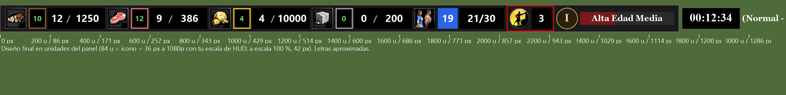

# Diseño del HUD propio: panel de recursos descripto en un archivo (2026-10-24)

## 1. Objetivo

El mod `BoCoach HUD` deja de heredar la disposición del panel de KoBHV o del original y pasa a tener un diseño propio,
descripto en un archivo del repo (`data/hud_layout.json`). De ese archivo salen las cuatro cosas que hoy están
acopladas a mano: el generador del mod, la calibración sola, el lector del HUD y el lugar donde el overlay dibuja la
GD. Dos metas a la vez: que al jugador le quede más lindo y legible, y que el OCR lea cada número de un rectángulo
conocido en vez de buscar bloques negros.

### Decisiones del usuario (2026-10-24)

1. El panel sigue **arriba a la izquierda**.
2. Estilo **oscuro y liso** (como Custom UI - Centered Modern): fondo parejo para todas las civs, **íconos originales
   del juego**, números blancos grandes.
3. **Se agrandan** los textos que hoy no entran bien ("N/M" pasa de 34 a 48 pt); las letras se rearman con una
   grabación del usuario.
4. Reparto **C** de la maqueta: cada recurso es `ícono · casillero del coach · aldeanos / stock` en un renglón. En
   población, el total de aldeanos va **sobre fondo azul** y después el "N/M".
5. Enfoque **1**: un solo archivo de diseño del que salen el mod, la calibración, el lector y el overlay. El lector
   viejo queda para el mod viejo y para jugar sin mod.

Lo que se supone y el usuario no objetó: el diseño es un archivo que afinamos nosotros (no un editor para el usuario
final); los recursos iniciales, la edad y el reloj se muestran como hoy.

## 2. Diseño visual



Todas las medidas van en **unidades del panel del juego** (el ícono original mide 84 unidades). Con la escala de HUD
del usuario, 84 unidades son 36 px a 1920×1080; a escala 100 % serían 42. El mod escala solo con la opción "Escala
del HUD" del juego y la calibración mide el factor.

| Elemento | Posición y tamaño (unidades) |
|---|---|
| Barra | 2720 × 108, gris oscuro liso (0,1, 0,1, 0,1) en los 9 estados de civ, borde de 2 unidades gris (0,44). Alto igual al que hoy se ve del panel original: no pisa la cola de producción. |
| Celda de recurso (madera, comida, oro, piedra) | 410 de ancho, desde x = 10, 420, 830, 1240. Ícono del juego 84×84 en (+10, 12). **Casillero del coach** 70×84 en (+104, 12), del color del recurso (entran dos cifras de GD con el marco). **Campo negro** 230×84 en (+180, 12) con los aldeanos (texto de 70 de ancho en +184, hasta 3 cifras) y el stock (132 de ancho en +274, entran 5 cifras), ambos blancos a 48 pt, separados por un "/" gris (20 de ancho en +254). |
| Población | 380 de ancho desde x = 1650. Ícono en (+10, 12). **Casillero azul** 80×84 en (+104, 12) con el total de aldeanos en blanco a 48 pt. Campo negro 180×84 en (+190, 12) con "N/M" blanco a 48 pt. `PopulationFlash` (parpadeo amarillo al tope) sobre ese campo. |
| Inactivos | 190 de ancho desde x = 2030. Botón del juego (ícono) 84×84 en (+10, 12), campo negro 80×84 en (+100, 12) con la cantidad a 48 pt. Sin casillero: el marco rojo lo dibuja la app. |
| Edad | 492 de ancho desde x = 2220. Medallón (`AgeUp`) 84×84 en (+10, 12); barra de progreso (`AgeBar`) 378×52 en (+104, 28) con el texto a 44 pt, como el original. |
| Reloj | Panel aparte (`worldtimerpanel.json`): rectángulo negro 230×84 a 14 unidades del final de la barra, reloj a 56 pt (sigue valiendo `mod_clock`). Espectadores e ID de partida debajo, como hoy. |

Colores de los casilleros (r, g, b de 0 a 1 en el JSON; entre paréntesis, lo que captura la pantalla): madera
(0,53, 0,36, 0,16) → (135, 92, 41); comida (0,88, 0,41, 0,42) → (225, 104, 106); oro (0,94, 0,75, 0,10) → (240, 192,
25); piedra (0,62, 0,62, 0,65) → (158, 158, 167); población (0,16, 0,39, 0,90) → (41, 100, 230). Los cuatro de
recursos son los de las franjas de hoy; el azul es más oscuro que la franja actual para que el blanco del total se
separe limpio (canal más bajo 41 contra el umbral 50 de la tinta).

Todos los textos van **centrados** en su campo (`TextAnchor: CentreCentre`, verificado en el mod de hoy); el lector
lee el campo entero, así que no importa dónde caigan las cifras. Fuente: el `FontIndex` del panel original (la que el
jugador eligió en opciones), como hoy.

## 3. El archivo de diseño: `data/hud_layout.json`

Lo cargan `BoCoach.Vision` (calibración y lector) y `BoCoach.App` (generador y overlay). `Core` no lo toca. Se copia
a la salida como el resto de `data/`. Extracto: las celdas de comida, oro y piedra son iguales a la de madera, con
su `x` y el color de su casillero.

```json
{
  "name": "bocoach-2026-10",
  "pixels_per_unit_at_1080p": 0.4286,
  "bar": { "width": 2720, "height": 108, "background": [0.1, 0.1, 0.1], "border": { "width": 2, "color": [0.44, 0.44, 0.44] } },
  "cells": {
    "wood": {
      "x": 10, "width": 410,
      "icon": { "x": 10, "y": 12, "size": 84 },
      "chip": { "x": 104, "y": 12, "width": 70, "height": 84, "color": [0.53, 0.36, 0.16] },
      "fields": {
        "villagers": { "x": 184, "y": 12, "width": 70, "height": 84, "font": "hud_numbers", "points": 48 },
        "stock": { "x": 274, "y": 12, "width": 132, "height": 84, "font": "hud_numbers", "points": 48 }
      },
      "backgrounds": [ { "x": 180, "y": 12, "width": 230, "height": 84 } ],
      "separator": { "x": 254, "y": 12, "width": 20, "height": 84, "text": "/", "points": 44, "color": [0.55, 0.55, 0.55] }
    },
    "food": { "...": "igual con x = 420" },
    "gold": { "...": "x = 830" },
    "stone": { "...": "x = 1240" },
    "population": {
      "x": 1650, "width": 380,
      "icon": { "x": 10, "y": 12, "size": 84 },
      "chip": { "x": 104, "y": 12, "width": 80, "height": 84, "color": [0.16, 0.39, 0.9] },
      "fields": {
        "total": { "x": 104, "y": 12, "width": 80, "height": 84, "font": "hud_numbers", "points": 48 },
        "cap": { "x": 190, "y": 12, "width": 180, "height": 84, "font": "hud_numbers", "points": 48 }
      },
      "backgrounds": [ { "x": 190, "y": 12, "width": 180, "height": 84 } ]
    },
    "idle": {
      "x": 2030, "width": 190,
      "icon": { "x": 10, "y": 12, "size": 84 },
      "fields": { "count": { "x": 100, "y": 12, "width": 80, "height": 84, "font": "hud_numbers", "points": 48 } },
      "backgrounds": [ { "x": 100, "y": 12, "width": 80, "height": 84 } ]
    },
    "age": {
      "x": 2220, "width": 492,
      "icon": { "x": 10, "y": 12, "size": 84 },
      "fields": { "text": { "x": 104, "y": 28, "width": 378, "height": 52, "font": "ocr", "points": 44 } }
    }
  },
  "clock": { "gap": 14, "y": 12, "width": 230, "height": 84, "font": "mod_clock", "points": 56 }
}
```

Reglas del formato:

- `pixels_per_unit_at_1080p` es el factor de referencia (84 unidades = 36 px): con él las cajas y las letras quedan
  medidas "a 1080p" como hoy, y `hud_scale` sigue significando lo mismo.
- Las coordenadas de ícono, casillero, campos, fondos y separador son **relativas a la celda**; `x` de la celda es
  relativo a la barra. El reloj se ubica por `gap` después del final de la barra.
- Cada campo tiene `font` (qué letra lo lee: `hud_numbers`, `mod_clock` u `ocr` para el OCR de Windows) y `points`
  (tamaño con que el mod lo escribe). El casillero es opcional (inactivos no tiene); en población el casillero y el
  campo `total` ocupan el mismo rectángulo (el fondo del campo es el casillero).
- El modelo en C# (`BoCoach.Vision/Hud/HudLayout.cs`): records `HudLayout`, `HudCell`, `HudField`, `HudChip`,
  carga con `System.Text.Json`, y helpers `PixelsAt(scale)`, `CellRect`, `FieldRect` (rectángulo de un campo dentro
  de la caja de su celda, en proporción). Validación al cargar: celdas sin solaparse y dentro de la barra, campos y
  casilleros dentro de su celda, nombres de campo conocidos por celda, fuentes conocidas.

Los widgets del juego que muestran cada cosa están en el código del generador, no en el JSON: `Wood`/`Food`/`Gold`/
`Stone` (contenedor y, adentro, `Workers` = aldeanos), `WoodStorage`... (stock), `Population` (+ `Workers` = total),
`PopulationCount` (N/M), `PopulationFlash`, `Idle` (botón) e `IdleWorkers`, `AgeUp` y `AgeBar` (+ `AgeTextLabel`),
y en el otro panel `WorldTimer` (+ `WorldTimerLabel`, `SpectatorsIcon`, `GameIDLabel`).

## 4. Generador del mod (`App/Capture/HudMod`)

- Parte **siempre del `resourcepanel.json` y el `worldtimerpanel.json` originales del juego** (no del mod activo ni
  del mod propio anterior): así conserva cada widget con su nombre, su tipo y su tooltip (`Help`) y la salida depende
  solo del diseño. Se quita el parámetro `regenerate` (ya no hace falta) y la descripción de `info.json` dice el
  nombre del diseño en vez de los mods de origen.
- Panel de recursos: la colección y el `Background` toman el tamaño de la barra; el `Background` pasa a
  `FlatColorWithAlpha` con el color de la barra en los 9 `UserState`, y se le agregan cuatro rectángulos finos como
  borde (`BoCoachBorder*`). Cada contenedor de recurso (`Wood`, etc.) queda **transparente y del tamaño de la celda**
  (material `None`, como el `UserState1` de `Population`), y como hijos, en coordenadas relativas a la celda: un
  `Base` con el material del ícono del juego (`ResourceWood`...), el casillero (`BoCoachChip`, color liso), los fondos
  negros (`BoCoachBack*`), el separador (`BoCoachSeparator`, un `Label` con texto fijo "/") y el `Workers` original
  reubicado y con la letra del campo. Las etiquetas hermanas (`WoodStorage`, `PopulationCount`, `IdleWorkers`) se
  reubican en coordenadas absolutas de la barra. `Idle` (botón) queda con sus materiales originales (ícono, hover,
  pressed) en la posición del ícono. `AgeUp` y `AgeBar` en la posición de la celda de edad. `PopulationFlash` sobre el
  campo "N/M". Los hijos nunca salen de los límites de su padre (si el juego recorta hijos, no se nota).
- Reloj: el fondo negro (`BoCoachClockBackground`) y el `WorldTimerLabel` toman el tamaño y la letra del diseño; la
  colección se corre para que el reloj quede a `gap` del final de la barra. **Riesgo:** no se sabe si el ancla del
  reloj suma su propio corrimiento al origen de la colección (XavilUI y Custom UI mueven la colección y el reloj cae en
  el origen; el original cae a 1730 unidades con la colección en 0). Se verifica en la primera prueba del usuario y se
  ajusta `clock.gap` o el origen; si el ancla es relativa al panel, no hace falta mover nada.
- Sigue instalando en todos los perfiles con carpeta `mods`, avisando de mods activos con más prioridad que toquen
  los dos paneles, y es idempotente por construcción (siempre parte del original).
- `ReplaySession hud-preview <salida.png> [--layout archivo] [--scale 1]` dibuja el diseño como imagen (barra,
  íconos del juego si está la instalación, casilleros, campos con números de ejemplo y el reloj) para retocar medidas
  sin abrir el juego. Es la maqueta de este documento, generada desde el JSON real.

## 5. Calibración sola (`Vision/Regions/AutoCalibration`)

- **Anclas:** los cinco casilleros (los cuatro de recursos y el azul de población) con los colores del diseño, buscados
  como hoy (rectángulos de color parejo en el 10 % de arriba de la pantalla, ahora hasta el 80 % del ancho; la GD del
  overlay parte el casillero en varios rectángulos del mismo ancho: se juntan y se estiran por los costados como hoy).
  Los colores de referencia salen del JSON, no de una tabla fija.
- **Ajuste:** factor píxeles por unidad = mediana de (ancho medido / ancho del casillero en unidades); origen del
  panel = mediana de (x medido − x del casillero × factor) y lo mismo en y. Escala respecto de 1080p = factor /
  `pixels_per_unit_at_1080p`. Se acepta si cada casillero medido cae a 3 px (a 1080p, escalados) de donde el diseño lo pone y su
  ancho difiere menos del 10 %; si no, no hay detección (y se prueba el camino del mod viejo: las seis franjas, como hoy).
- **Cajas:** cada celda entera (recursos, población, inactivos), la barra de edad y el reloj salen del diseño por el
  factor y el origen. La del reloj se afina buscando el rectángulo negro cerca de donde el diseño lo predice (±40 px a
  1080p): cubre el riesgo del ancla. Cola de producción, log y puntajes como hoy (escalados o pegados a los bordes).
- `regions.json` guarda en `hud_layout` el diseño entero (el objeto del JSON, con su `name`) además de `hud_scale`;
  `session.json` de las grabaciones igual (`RecordedSession`). Así una calibración o una grabación vieja se lee con
  el diseño exacto con que se hizo aunque el de la app cambie después. `AutoCalibrationResult` trae el diseño y el factor; el estado de la calibración en la
  ventana dice "diseño bocoach-2026-10, escala 1,00".

## 6. Lector (`Vision/Hud/HudReader` y `ScreenReader`)

- Con `hud_layout` en la calibración (o en la grabación; `ScreenReader` recibe el `HudLayout` que traen
  `RegionLayout` o `RecordedSession`, null si no hay), cada campo se recorta **dentro de la caja de su celda por
  las proporciones del diseño** (`HudLayout.FieldRect`) y se afina a los bordes del fondo negro con 3 px de tolerancia a
  1080p (el campo "total" de población, sobre azul, se afina por el azul). Antes de confiar en el diseño, el
  lector verifica que el casillero esté donde el diseño dice (color parejo del casillero en ese rectángulo, como hoy
  `HasBandAbove`); si no está, cae al camino de hoy (`ModPanel` para el mod viejo, letras de siempre sin mod). Así
  las tres grabaciones viejas, los fixtures y una PC sin el mod siguen igual.
- Cada campo se lee con la letra que dice su `font`: `hud_numbers` (nueva: 48 pt, tinta blanca de 50 a 150, dígitos y
  "/") para aldeanos, stock, total, "N/M" e inactivos; `mod_clock` para el reloj (56 pt, misma letra y fondo que hoy);
  la edad sigue con el OCR de Windows (`AgeText`). El estirado de brillo en pausa se aplica igual que hoy.
- `HudReading` no cambia de forma: `VillagersOn`, `Population`, `PopulationCap`, `Villagers`, `IdleVillagers`,
  `Clipped` y `ModBands`. `ModBands` pasa a traer el **casillero** de cada recurso (en píxeles de su caja) y, en
  inactivos, la **celda entera**. `HudState`/`ScreenReading` suman `LayoutName` (null con el mod viejo o sin mod) para
  que el overlay sepa cómo dibujar.
- Letras: `HudFonts` suma `HudNumbers` (opcional, `data/fonts/hud_numbers.json`); sin ella el camino nuevo no lee
  números (se avisa en el panel "Lo que ve el coach" y en el diagnóstico).

## 7. Overlay (`App/Overlay`)

- **GD en el casillero:** la app dibuja dentro del casillero dejando un marco de 2 px (a 1080p; escala con el HUD)
  del color del recurso, un fondo negro adentro y el número con el color de estado de siempre (verde coincide, rojo
  faltan, amarillo sobran, blanco si no se sabe). El marco visible es lo que la calibración sigue viendo por los
  costados. Sin la app el casillero queda de color liso.
- **Inactivos:** marco rojo y amarillo alternado (350 ms) alrededor de la celda entera, de 3 px, sin fondo. En
  población no se dibuja nada.
- `ResourceOverlay` recibe el modo (`LayoutName != null`) desde `OverlayViewModel` y elige entre casillero (nuevo),
  franja (mod viejo) y debajo de la caja (sin mod). `--overlay-screenshot ... --bands` dibuja el caso nuevo.

## 8. Letras, fixtures y tests

- `ReplaySession glyphs` acepta campos del diseño (`wood:stock,population:cap,idle:count`) además de
  `región:square|stock`, recortando con `HudLayout.FieldRect`. Con eso se arma `data/fonts/hud_numbers.json` desde la
  grabación del usuario (`font ... hud_numbers white-on-black`), siguiendo la skill `armar-letras-e-iconos`.
  `mod_numbers` y `mod_population` quedan para el mod viejo.
- Fixtures nuevos: `tests/fixtures/hud-<fecha>/` con unas capturas por región de la grabación del usuario y su golden,
  y `tests/fixtures/screens/hud-layout-<fecha>-1080p.png` (la captura de diagnóstico con el mapa en negro, como las
  otras pantallas).
- Tests:
  - `HudLayoutTests` (Vision.Tests): carga de `data/hud_layout.json`, celdas sin solaparse y dentro de la barra, campos
    dentro de su celda, `FieldRect` a escala 1 y 1,5, errores claros ante un JSON roto.
  - `HudModTests` (App.Tests, reescritos): widgets originales conservados con sus `Help`, posiciones según el diseño,
    fondo liso en los 9 estados, `PopulationFlash` sobre "N/M", aplicarlo dos veces da lo mismo, instala en cada perfil.
  - `AutoCalibrationTests`: una pantalla sintética dibujada desde el diseño (casilleros y fondos exactos, números
    cualquiera) a escala 1 y 1,5 → cajas a ±2 px; sigue el test del mod viejo con `hud-20261018-132830` y la pantalla
    del amigo.
  - `HudReaderTests`: lectura contra el golden del fixture nuevo (reloj, stocks, aldeanos por recurso, total, N/M,
    inactivos al 100 % en las capturas elegidas), y que las grabaciones viejas se leen igual.
  - `ResourceOverlay` por captura (`--overlay-screenshot --bands`) y `ReplaySession coach` sobre la grabación nueva.
- Docs al cierre: `CLAUDE.md` (estado y cómo funciona), `PLAN.md` sección 11 D9 (apunta acá), `docs/pendientes-usuario.md`
  (los pasos del usuario), `LEEME.txt` si cambia algo para quien instala. `tools/mod/instalar-mod.ps1` queda con una
  nota al principio de que ya no refleja el diseño nuevo (no se borra).

## 9. Orden de trabajo y lo que hace el usuario

1. Diseño (`hud_layout.json`, `HudLayout`), generador y `hud-preview`, con sus tests. Sin el usuario.
2. Calibración, lector y overlay con la pantalla sintética. Sin el usuario.
3. Versión nueva (v0.9.34, rama `fase-9-refinamiento`) e instrucciones en `docs/pendientes-usuario.md`.
4. **El usuario (unos 10 minutos):** actualizar la app, tocar "Instalar mod del HUD", abrir una escaramuza, dejar que
   calibre sola, grabar 2 o 3 minutos con Ctrl+Alt+R moviendo aldeanos por los cuatro recursos y dejando alguno
   inactivo, sacar una captura de diagnóstico con Ctrl+Alt+X. Mirar: que el "/" se vea, que la barra no tape la cola
   de producción, que el reloj quede pegado a la barra, y que los tooltips sigan al pasar el mouse.
5. Con la grabación: `hud_numbers`, golden, fixtures, tests de lectura; `ReplaySession coach` sobre la grabación.
6. Prueba en vivo del overlay (GD en los casilleros, marco de inactivos) en una partida.

## 10. Riesgos y qué verificar en el juego

- El "/" como `Label` con texto fijo: si el juego no muestra textos que no son suyos, el separador pasa a ser una
  barrita gris vertical (`Base` de 4 unidades) sin cambiar el formato (`separator.text` null → barrita).
- El ancla del reloj (sección 4).
- Hijos fuera del padre: el diseño no los tiene; si el juego recortara igual, se ve en la primera captura.
- Material `None` en el contenedor de la celda: se usa ya en `Population` (UserState1). Si el tooltip de la celda no
  apareciera, alternativa `FlatColorWithAlpha` con alfa 0.
- La letra del juego depende de la opción de fuente del jugador (clásica o sans): `hud_numbers` se arma con la del
  usuario, como hoy `mod_numbers`; otra fuente necesita sus propias letras (ya pasa hoy).
- Con la escala de HUD al 100 % la barra mide 1360 px y el reloj termina en 1480 a 1920 de ancho: antes de los
  botones del menú (desde ~1700). A 1600×900 o con escalas mayores hay que mirar que no se pisen; si pasa, se
  achican los anchos de celda en el JSON.

## 11. Fuera de alcance

- Mover el panel a otro lugar de la pantalla (quedó arriba a la izquierda; el diseño no tiene origen).
- Panel dibujado como imagen (PNG por grupo de civ): posible pulido después.
- Leer la cola de producción o el log de otra forma: no cambian.
- Un editor del diseño dentro de la app.
